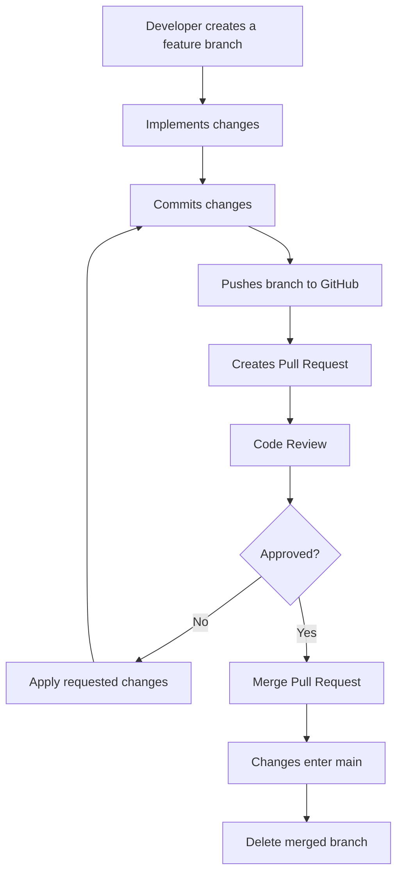
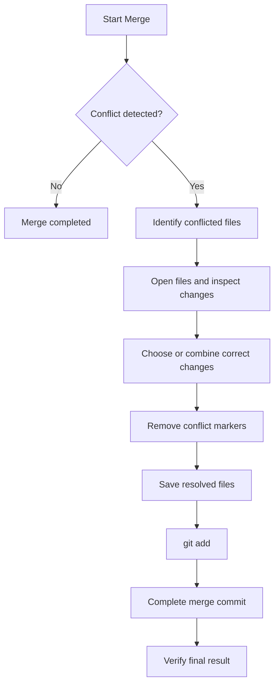

# راهنمای جامع ادغام شاخه‌ها (Merging) در Git و GitHub

این مستند با هدف آموزش مفاهیم، سازوکارها و روش‌های مختلف ادغام تغییرات در Git تهیه شده است. در پروژه‌های نرم‌افزاری، توسعه‌دهندگان معمولاً به‌صورت هم‌زمان روی بخش‌های مختلف یک پروژه کار می‌کنند. برای ترکیب تغییرات ایجادشده در شاخه‌های مستقل و حفظ یکپارچگی پروژه، از مفهومی به نام **Merge** استفاده می‌شود.

در این راهنما، علاوه بر آشنایی با مفهوم ادغام و انواع آن، نحوه انجام Merge در محیط محلی، ادغام تغییرات از طریق GitHub Pull Request و شناسایی و حل تعارض‌های احتمالی (Merge Conflicts) به‌صورت گام‌به‌گام بررسی می‌شود.

---

## فهرست مطالب

1. [مفهوم Merge و ضرورت آن](#1-مفهوم-merge-و-ضرورت-آن)

2. [مفاهیم پایه موردنیاز](#2-مفاهیم-پایه-موردنیاز)

3. [ساختار داخلی Merge در Git](#3-ساختار-داخلی-merge-در-git)

4. [انواع Merge](#4-انواع-merge)

5. [تفاوت Merge و Rebase](#5-تفاوت-merge-و-rebase)

6. [انجام Merge در محیط محلی](#6-انجام-merge-در-محیط-محلی)

7. [ادغام تغییرات با GitHub Pull Request](#7-ادغام-تغییرات-با-github-pull-request)

8. [آشنایی با Merge Conflict](#8-آشنایی-با-merge-conflict)

9. [شبیه‌سازی و حل یک Merge Conflict](#9-شبیه‌سازی-و-حل-یک-merge-conflict)

10. [دستورات کاربردی و مدیریت خطاها](#10-دستورات-کاربردی-و-مدیریت-خطاها)

11. [بهترین روش‌ها و نکات حرفه‌ای](#11-بهترین-روش‌ها-و-نکات-حرفه‌ای)

---

## 1. مفهوم Merge و ضرورت آن

### 1.1. Merge چیست؟

در Git، هر شاخه (Branch) یک مسیر مستقل برای توسعه پروژه محسوب می‌شود. توسعه‌دهندگان می‌توانند بدون ایجاد اختلال در کار یکدیگر، تغییرات موردنظرشان را در شاخه‌های جداگانه ایجاد و ثبت کنند.

اما در نهایت، این تغییرات باید در یک شاخه مشترک، معمولاً `main`، ترکیب شوند.

**Merge عملیاتی است که تغییرات دو شاخه را با یکدیگر ترکیب می‌کند.**

برای مثال، فرض کنید دو توسعه‌دهنده روی یک پروژه کار می‌کنند:

- توسعه‌دهنده اول در شاخه `feature/login` قابلیت ورود کاربران را پیاده‌سازی می‌کند.

- توسعه‌دهنده دوم در شاخه `feature/register` قابلیت ثبت‌نام کاربران را توسعه می‌دهد.

پس از تکمیل این قابلیت‌ها، باید تغییرات هر دو شاخه در شاخه اصلی پروژه قرار بگیرند.

### 1.2. چرا به Merge نیاز داریم؟

بدون استفاده از شاخه‌ها، اعضای تیم مجبور می‌شوند تغییرات خود را مستقیماً روی یک نسخه مشترک اعمال کنند. این مسئله می‌تواند باعث تداخل تغییرات، از بین رفتن کدها و دشوار شدن مدیریت پروژه شود.

قابلیت Merge این امکان را فراهم می‌کند که:

- اعضای تیم به‌صورت مستقل و هم‌زمان کار کنند.

- تغییرات هر قابلیت به‌صورت جداگانه توسعه و بررسی شود.

- پس از تأیید، تغییرات در پروژه اصلی ترکیب شوند.

- تاریخچه تغییرات و ارتباط میان شاخه‌ها حفظ شود.

- تعارض‌های احتمالی پیش از ورود تغییرات به شاخه اصلی شناسایی و مدیریت شوند.

### 1.3. نمای کلی فرآیند Merge

```text

                  main

                    |

              [Commit A]

                    |

             +------+------+

             |             |

             v             v

       feature/login   feature/register

             |             |

         [Commit B]    [Commit C]

             |             |

         [Commit D]    [Commit E]

             |             |

             +------+------+

                    |

                  MERGE

                    |

              [Commit M]

                    |

                  main

```

در این ساختار، دو شاخه به‌صورت مستقل توسعه پیدا کرده‌اند و در نهایت تغییرات آن‌ها در شاخه اصلی ترکیب شده است.

---

## 2. مفاهیم پایه موردنیاز

برای درک دقیق Merge، ابتدا باید با چند مفهوم اساسی Git آشنا باشیم.

| مفهوم | توضیح |

|---|---|

| Repository | مخزن شامل فایل‌ها و تاریخچه تغییرات پروژه |

| Branch | شاخه‌ای مستقل از تاریخچه توسعه پروژه |

| Commit | ثبت یک مجموعه تغییرات در تاریخچه Git |

| HEAD | اشاره‌گر به Commit یا شاخه‌ای که در حال حاضر در آن قرار داریم |

| Parent Commit | کامیتی که یک Commit از آن منشعب شده است |

| Merge Base | آخرین Commit مشترک دو شاخه که Git برای مقایسه تغییرات از آن استفاده می‌کند |

| Remote | نسخه‌ای از مخزن که روی سرور، مانند GitHub، قرار دارد |

| Conflict | وضعیتی که Git نمی‌تواند تغییرات دو شاخه را به‌صورت خودکار ترکیب کند |

### 2.1. Merge Base چیست؟

یکی از مهم‌ترین مفاهیم در عملیات Merge، مفهوم Merge Base است.

فرض کنید دو شاخه از یک Commit مشترک ایجاد شده‌اند و پس از آن هرکدام تغییرات مستقلی داشته‌اند.

مفهوم Merge Base به آخرین Commit مشترک در تاریخچه دو شاخه اشاره دارد.

در فرآیند ادغام، Git تغییرات هر شاخه را نسبت به این نقطه مشترک بررسی می‌کند تا بتواند نتیجه ترکیب را محاسبه کند.

```text

                 Commit A

                     |

                 Commit B

                     |

              Merge Base (B)

                 /       \

                /         \

          Commit C       Commit D

              |               |

          Commit E       Commit F

                \         /

                 \       /

                  Merge

```

در این مثال، Commit B نقطه مشترک دو شاخه است.

در این مرحله، Git تغییرات شاخه اول از B تا E و تغییرات شاخه دوم از B تا F را بررسی می‌کند.

---

## 3. ساختار داخلی Merge در Git

برای درک بهتر عملکرد Git، باید بدانیم Merge صرفاً کپی کردن فایل‌های یک شاخه روی شاخه دیگر نیست.

برای انجام این کار، Git تاریخچه Commitها را بررسی می‌کند و بر اساس ارتباط آن‌ها، تصمیم می‌گیرد که چگونه تغییرات را ترکیب کند.

در یک Merge معمولی، Git سه نسخه را در نظر می‌گیرد:

1. **Base:** نسخه فایل در آخرین Commit مشترک دو شاخه.

2. **Ours:** نسخه فایل در شاخه‌ای که عملیات Merge روی آن انجام می‌شود.

3. **Theirs:** نسخه فایل در شاخه‌ای که قرار است با شاخه فعلی ادغام شود.

این فرآیند با نام Three-Way Merge شناخته می‌شود.

```text

             BASE

          (Commit B)

               |

        +------+------+

        |             |

        v             v

      OURS          THEIRS

   (Branch A)      (Branch B)

        |             |

        +------+------+

               |

         Three-Way

           Merge

               |

               v

         MERGE RESULT

```

اگر تغییرات دو شاخه با یکدیگر تداخل نداشته باشند، Git می‌تواند نتیجه را به‌صورت خودکار تولید کند.

اما اگر تغییرات با یکدیگر ناسازگار باشند، Merge Conflict ایجاد می‌شود.

---

## 4. انواع Merge

بسته به وضعیت تاریخچه دو شاخه، Git می‌تواند عملیات Merge را به روش‌های مختلف انجام دهد.

### 4.1. Fast-Forward Merge

این نوع Merge زمانی اتفاق می‌افتد که شاخه مقصد از زمان ایجاد شاخه دیگر هیچ Commit جدیدی نداشته باشد.

در این شرایط، Git نیازی به ساخت Commit جدید برای ادغام ندارد؛ بلکه فقط اشاره‌گر شاخه مقصد را به آخرین Commit شاخه مبدأ منتقل می‌کند.

**مثال:**

```text

قبل از Merge:

A---B---C  main

         \

          D---E  feature

بعد از Fast-Forward Merge:

A---B---C---D---E  main, feature

```

در این مثال، شاخه `main` از Commit C منشعب شده و تغییرات جدیدی نداشته است. بنابراین Git می‌تواند آن را مستقیماً به Commit E منتقل کند.

**دستور:**

```bash

git switch main

git merge feature

```

اگر شرایط Fast-Forward برقرار باشد، Git به‌صورت پیش‌فرض از این روش استفاده می‌کند.

برای جلوگیری از Fast-Forward و ایجاد یک Merge Commit مستقل می‌توان از دستور زیر استفاده کرد:

```bash

git merge --no-ff feature

```

### 4.2. Three-Way Merge

اگر هر دو شاخه پس از نقطه مشترک خود Commitهای جدیدی داشته باشند، دیگر امکان Fast-Forward وجود ندارد.

در این حالت Git از Three-Way Merge استفاده می‌کند.

**مثال:**

```text

قبل از Merge:

          C---D  feature

         /

A---B---+

         \

          E---F  main

بعد از Three-Way Merge:

          C---D

         /     \

A---B---+       M  main

         \     /

          E---F

```

در این ساختار، Commit M یک Merge Commit است که دو والد (Parent) دارد:

- والد اول: آخرین Commit شاخه مقصد، یعنی F.

- والد دوم: آخرین Commit شاخه مبدأ، یعنی D.

این Commit نشان می‌دهد که دو مسیر مستقل توسعه با یکدیگر ادغام شده‌اند.

**دستور:**

```bash

git switch main

git merge feature

```

اگر تغییرات قابل ترکیب باشند، Git به‌صورت خودکار Merge Commit را ایجاد می‌کند.

### 4.3. Squash Merge

در Squash Merge، تمام Commitهای یک شاخه به یک مجموعه تغییرات تبدیل می‌شوند و سپس به شکل یک Commit جدید در شاخه مقصد ثبت می‌شوند.

در این روش، Commitهای اصلی شاخه مبدأ به‌عنوان Commitهای جداگانه وارد تاریخچه شاخه مقصد نمی‌شوند.

**قبل از Squash Merge:**

```text

main:       A---B

feature:         C---D---E

```

**بعد از Squash Merge:**

```text

main:       A---B---S

```

در این مثال، Commitهای C، D و E در قالب یک Commit جدید به نام S ثبت شده‌اند.

**دستور:**

```bash

git switch main

git merge --squash feature

git commit -m "Add feature implementation"

```

نکته مهم: دستور `git merge --squash` تغییرات را در محیط کاری و Staging آماده می‌کند، اما خودش Merge Commit ایجاد نمی‌کند؛ بنابراین باید با دستور `git commit` تغییرات ثبت شوند.

### 4.4. مقایسه انواع Merge

| ویژگی | Fast-Forward | Three-Way | Squash |

|---|---|---|---|

| ایجاد Merge Commit | خیر | بله | خیر |

| حفظ Commitهای مستقل در تاریخچه مقصد | بله | بله | خیر |

| نیاز به نقطه مشترک | بله | بله | بله |

| مناسب برای | شاخه‌های بدون انشعاب جدید در مقصد | شاخه‌های دارای تاریخچه مستقل | ترکیب تغییرات در یک Commit |

| حفظ ارتباط دو شاخه در تاریخچه | به‌صورت ساختار Commitها | بله، با دو والد | به شکل Merge Commit خیر |

---

## 5. تفاوت Merge و Rebase

دو روش Merge و Rebase هر دو برای ترکیب تغییرات شاخه‌ها استفاده می‌شوند؛ اما تاریخچه پروژه را به شکل متفاوتی تغییر می‌دهند.

### 5.1. Merge

در روش Merge، دو مسیر توسعه به یکدیگر متصل می‌شوند و در صورت نیاز یک Merge Commit ساخته می‌شود.

```text

          C---D

         /     \

A---B---+       M

         \     /

          E---F

```

مزایا:

- تاریخچه واقعی توسعه حفظ می‌شود.

- مشخص است که چه زمانی دو شاخه ادغام شده‌اند.

- Commitهای اصلی تغییر نمی‌کنند.

- برای همکاری تیمی و شاخه‌های مشترک مناسب است.

### 5.2. Rebase

در Rebase، Commitهای یک شاخه روی انتهای شاخه دیگری بازسازی می‌شوند.

به زبان ساده، Git تغییرات Commitهای شاخه را دوباره روی پایه جدید اعمال می‌کند و برای آن‌ها Commitهای جدیدی می‌سازد.

**قبل از Rebase:**

```text

          C---D  feature

         /

A---B---+

         \

          E---F  main

```

**بعد از Rebase:**

```text

A---B---E---F---C'---D'  feature

```

در این مثال، Commitهای C و D با Commitهای جدید C' و D' جایگزین شده‌اند.

مزایا:

- تاریخچه خطی و ساده‌تری ایجاد می‌کند.

- خواندن تاریخچه پروژه آسان‌تر می‌شود.

- می‌توان پیش از ادغام، شاخه را با آخرین تغییرات شاخه مقصد هماهنگ کرد.

معایب و محدودیت‌ها:

- تاریخچه Commitها بازنویسی می‌شود.

- شناسه Commitها تغییر می‌کند.

- استفاده نادرست از آن روی شاخه‌های مشترک ممکن است کار سایر اعضای تیم را مختل کند.

### 5.3. مقایسه نهایی

| ویژگی | Merge | Rebase |

|---|---|---|

| بازنویسی Commitها | خیر | بله |

| حفظ تاریخچه واقعی شاخه‌ها | بله | خیر، تاریخچه بازسازی می‌شود |

| ایجاد Merge Commit | در Three-Way Merge بله | خیر |

| ساختار تاریخچه | ممکن است شاخه‌ای باشد | معمولاً خطی |

| مناسب برای | ادغام شاخه‌های تیمی | مرتب‌سازی تاریخچه شاخه شخصی |

**نکته مهم:** در پروژه‌های گروهی، برای شاخه‌هایی که چند نفر از آن استفاده می‌کنند، بازنویسی تاریخچه با Rebase باید با احتیاط انجام شود. Merge معمولاً انتخاب امن‌تری برای ادغام شاخه‌های مشترک است.

---

## 6. انجام Merge در محیط محلی

در این بخش، یک مثال عملی را بررسی می‌کنیم.

فرض کنید شاخه‌ای به نام `feature/login` داریم که قابلیت ورود کاربران در آن توسعه یافته است و اکنون می‌خواهیم تغییرات آن را وارد `main` کنیم.

### گام اول: مشاهده شاخه‌های موجود

```bash

git branch

```

این دستور شاخه‌های محلی را نمایش می‌دهد.

### گام دوم: ورود به شاخه مقصد

```bash

git switch main

```

برای انجام Merge باید ابتدا وارد شاخه‌ای شویم که قرار است تغییرات در آن قرار بگیرند.

در این مثال، شاخه مقصد `main` است.

### گام سوم: دریافت آخرین تغییرات شاخه مقصد

```bash

git pull origin main

```

این دستور تغییرات جدید شاخه اصلی روی GitHub را دریافت و با شاخه محلی `main` ترکیب می‌کند.

### گام چهارم: اجرای Merge

```bash

git merge feature/login

```

با اجرای این دستور، تغییرات شاخه `feature/login` با شاخه فعلی یعنی `main` ادغام می‌شوند.

### گام پنجم: بررسی نتیجه

```bash

git status

```

برای مشاهده تاریخچه Commitها نیز می‌توان از دستور زیر استفاده کرد:

```bash

git log --oneline --graph --all

```

### گام ششم: ارسال تغییرات به GitHub

```bash

git push origin main

```

این دستور Commitهای جدید شاخه محلی `main` را به شاخه اصلی روی GitHub ارسال می‌کند.

**توجه:** در پروژه‌های تیمی، اگر سیاست مخزن استفاده از Pull Request باشد، نباید Merge محلی را مستقیماً به `main` Push کنید. در این شرایط، Merge باید از طریق Pull Request و مطابق مجوزها و قوانین مخزن انجام شود.

### نمای کلی فرآیند

```text

       feature/login

              |

        [Development]

              |

          [Commits]

              |

              v

       git switch main

              |

              v

       git pull origin main

              |

              v

       git merge feature/login

              |

              v

         git status

              |

              v

       git push origin main

              |

              v

          GitHub main

```

---

## 7. ادغام تغییرات با GitHub Pull Request

در پروژه‌های گروهی، معمولاً بهتر است ادغام تغییرات از طریق Pull Request انجام شود.

در GitHub، Pull Request یا PR درخواستی برای بررسی و ادغام تغییرات یک شاخه در شاخه دیگر است.

در واقع، PR به اعضای تیم اجازه می‌دهد قبل از ورود تغییرات به شاخه اصلی، آن‌ها را مشاهده، بررسی و درباره آن‌ها نظر بدهند.

### 7.1. ساختار یک Pull Request

هر Pull Request دو شاخه اصلی دارد:

- **Base Branch:** شاخه‌ای که قرار است تغییرات وارد آن شود.

- **Compare Branch:** شاخه‌ای که تغییرات جدید در آن قرار دارند.

برای مثال:

```text

Base Branch:     main

Compare Branch:  feature/login

```

یعنی درخواست داریم تغییرات `feature/login` وارد `main` شوند.

### 7.2. چرخه ادغام در GitHub



### 7.3. مراحل انجام Merge در GitHub

**مرحله اول: ارسال شاخه به GitHub**

پس از تکمیل تغییرات، شاخه خود را Push می‌کنیم:

```bash

git push -u origin feature/login

```

گزینه `-u` ارتباط شاخه محلی با شاخه ریموت را تنظیم می‌کند تا در Push و Pullهای بعدی نیازی به نوشتن نام Remote و Branch نباشد.

**مرحله دوم: ایجاد Pull Request**

1. وارد مخزن پروژه در GitHub شوید.

2. وارد تب Pull Requests شوید.

3. روی New Pull Request کلیک کنید.

4. شاخه مقصد را در قسمت Base انتخاب کنید.

5. شاخه دارای تغییرات را در قسمت Compare انتخاب کنید.

6. عنوان و توضیحات مناسب برای درخواست بنویسید.

7. در صورت نیاز اعضای تیم را به‌عنوان Reviewer انتخاب کنید.

8. روی Create Pull Request کلیک کنید.

**مرحله سوم: بررسی تغییرات**

در صفحه Pull Request، اعضای تیم می‌توانند:

- تغییرات را مشاهده کنند.

- کدها و مستندات را بررسی کنند.

- روی خطوط مشخص کامنت بگذارند.

- اصلاحات لازم را درخواست کنند.

- درخواست را تأیید کنند.

اگر توسعه‌دهنده پس از بازبینی تغییر جدیدی ایجاد و به همان شاخه Push کند، تغییرات به‌صورت خودکار به Pull Request اضافه می‌شوند.

**مرحله چهارم: ادغام Pull Request**

پس از تأیید و برآورده شدن شرایط مخزن، می‌توان از یکی از روش‌های ادغام GitHub استفاده کرد:

1. Create a merge commit

2. Squash and merge

3. Rebase and merge

انتخاب روش مناسب به سیاست تیم و تنظیمات مخزن بستگی دارد.

**مرحله پنجم: پاکسازی شاخه**

پس از ادغام موفق، اگر دیگر به شاخه نیازی نباشد، می‌توان آن را حذف کرد.

حذف شاخه از GitHub معمولاً از طریق گزینه Delete branch در صفحه Pull Request انجام می‌شود.

برای حذف شاخه محلی:

```bash

git switch main

git pull origin main

git branch -d feature/login

```

---

## 8. آشنایی با Merge Conflict

### 8.1. Merge Conflict چیست؟

تعارض ادغام یا Merge Conflict زمانی رخ می‌دهد که Git نتواند تغییرات دو شاخه را به‌صورت خودکار ترکیب کند.

این وضعیت معمولاً زمانی اتفاق می‌افتد که دو شاخه تغییرات ناسازگاری روی یک بخش از یک فایل ایجاد کرده باشند.

برای مثال، فرض کنید دو توسعه‌دهنده فایل `README.md` را به شکل زیر تغییر داده‌اند:

نسخه شاخه اول:

```text

Project Status: In Development

```

نسخه شاخه دوم:

```text

Project Status: Completed

```

در این شرایط، Git نمی‌تواند تشخیص دهد کدام وضعیت باید در نسخه نهایی قرار بگیرد؛ بنابراین از توسعه‌دهنده می‌خواهد تعارض را برطرف کند.

### 8.2. چرا Conflict رخ می‌دهد؟

مهم‌ترین دلایل ایجاد Conflict عبارت‌اند از:

- تغییر یک خط مشترک در دو شاخه مختلف.

- حذف یک فایل در یک شاخه و ویرایش همان فایل در شاخه دیگر.

- تغییرات ناسازگار در بخش‌های نزدیک یا هم‌پوشان یک فایل.

- تغییر ساختار فایل‌ها در شاخه‌های مختلف.

**نکته:** هر تغییری در یک فایل الزاماً باعث Conflict نمی‌شود. اگر دو توسعه‌دهنده بخش‌های مستقل و غیرمتداخل یک فایل را تغییر دهند، Git معمولاً می‌تواند تغییرات را خودکار ترکیب کند.

### 8.3. نحوه نمایش Conflict در فایل

هنگام بروز تعارض، Git بخش موردنظر را با نشانه‌هایی مشخص می‌کند:

```text

<<<<<<< HEAD

Project Status: In Development

=======

Project Status: Completed

>>>>>>> feature/update-status

```

معنی این نشانه‌ها:

| نشانه | مفهوم |

|---|---|

| `<<<<<<< HEAD` | شروع تغییرات شاخه فعلی |

| `=======` | جداکننده دو نسخه متعارض |

| `>>>>>>> feature/update-status` | پایان تغییرات شاخه‌ای که در حال ادغام آن هستیم |

در این مثال:

- بخش بالایی مربوط به شاخه فعلی است.

- بخش پایینی مربوط به شاخه‌ای است که قرار است ادغام شود.

### 8.4. روش حل Conflict

برای حل Conflict باید:

1. فایل دارای تعارض را باز کنیم.

2. تغییرات هر دو شاخه را بررسی کنیم.

3. تصمیم بگیریم چه محتوایی باید در نسخه نهایی باقی بماند.

4. نشانه‌های Conflict را حذف کنیم.

5. نسخه نهایی و صحیح فایل را ذخیره کنیم.

6. فایل را با `git add` به‌عنوان حل‌شده علامت‌گذاری کنیم.

7. عملیات Merge را تکمیل کنیم.

### 8.5. نمودار فرآیند حل تعارض



---

## 9. شبیه‌سازی و حل یک Merge Conflict

برای درک بهتر، یک سناریوی عملی را بررسی می‌کنیم.

فرض کنید دو توسعه‌دهنده به نام‌های Developer A و Developer B روی یک مخزن مشترک کار می‌کنند.

هر دو از شاخه `main` شروع کرده‌اند و هرکدام یک شاخه جداگانه ساخته‌اند.

### مرحله اول: ساخت شاخه اول

```bash

git switch main

git switch -c conflict-branch-1

```

در این شاخه، فایل `README.md` را باز کرده و یک خط مشخص را به شکل زیر تغییر دهید:

```text

Project Status: In Development

```

سپس تغییرات را ثبت کنید:

```bash

git add README.md

git commit -m "Update project status to development"

```

### مرحله دوم: ساخت شاخه دوم

ابتدا به `main` بازگردید:

```bash

git switch main

```

حالا شاخه دوم را ایجاد کنید:

```bash

git switch -c conflict-branch-2

```

همان خط در فایل `README.md` را به شکل دیگری تغییر دهید:

```text

Project Status: Completed

```

سپس تغییرات را ثبت کنید:

```bash

git add README.md

git commit -m "Update project status to completed"

```

اکنون دو شاخه تغییرات متفاوتی روی یک خط مشترک دارند.

### مرحله سوم: ادغام شاخه اول در main

```bash

git switch main

git merge conflict-branch-1

```

در این مرحله تغییرات شاخه اول وارد `main` می‌شوند.

### مرحله چهارم: تلاش برای ادغام شاخه دوم

```bash

git merge conflict-branch-2

```

از آنجا که شاخه دوم نیز همان خط را به شکل متفاوتی تغییر داده است، Git نمی‌تواند تصمیم بگیرد کدام نسخه صحیح است.

در نتیجه Merge Conflict ایجاد می‌شود.

### مرحله پنجم: بررسی وضعیت

```bash

git status

```

در این مرحله، Git فایل‌های دارای تعارض را مشخص می‌کند.

### مرحله ششم: حل تعارض

فایل `README.md` را باز کنید.

محتوای آن ممکن است به شکل زیر باشد:

```text

<<<<<<< HEAD

Project Status: In Development

=======

Project Status: Completed

>>>>>>> conflict-branch-2

```

فرض کنید تصمیم نهایی تیم این است که وضعیت پروژه همچنان در حال توسعه باشد.

پس محتوای نهایی را به شکل زیر تغییر می‌دهیم:

```text

Project Status: In Development

```

تمام نشانه‌های Conflict باید حذف شوند.

### مرحله هفتم: تکمیل عملیات Merge

پس از ذخیره فایل:

```bash

git add README.md

```

سپس Merge را با ثبت Commit نهایی تکمیل می‌کنیم:

```bash

git commit -m "Resolve merge conflict in README"

```

### مرحله هشتم: بررسی نتیجه

```bash

git status

git log --oneline --graph --all

```

در نهایت، تغییرات هر دو شاخه در تاریخچه پروژه قابل مشاهده خواهند بود و تعارض نیز برطرف شده است.

**نکته مهم:** در این سناریو فرض کردیم توسعه‌دهنده در حال ادغام `conflict-branch-2` در `main` است. بنابراین `HEAD` به شاخه `main` اشاره می‌کند و نسخه شاخه دوم در سمت مقابل تعارض قرار دارد.

---

## 10. دستورات کاربردی و مدیریت خطاها

در این بخش مهم‌ترین دستورات مرتبط با Merge را مرور می‌کنیم.

| دستور | کاربرد |

|---|---|

| `git branch` | مشاهده شاخه‌های محلی |

| `git branch -a` | مشاهده شاخه‌های محلی و ریموت |

| `git switch main` | جابه‌جایی به شاخه main |

| `git merge feature` | ادغام feature در شاخه فعلی |

| `git merge --no-ff feature` | اجبار به ایجاد Merge Commit حتی در صورت امکان Fast-Forward |

| `git merge --ff-only feature` | انجام Merge فقط در صورت امکان Fast-Forward |

| `git merge --squash feature` | آماده‌سازی تغییرات برای ادغام به‌صورت یک Commit |

| `git merge --abort` | لغو عملیات Merge در حال انجام |

| `git status` | مشاهده وضعیت مخزن و فایل‌های دارای تعارض |

| `git log --oneline --graph --all` | مشاهده گراف تاریخچه Commitها |

| `git fetch origin` | دریافت اطلاعات و Commitهای جدید Remote بدون ادغام در شاخه فعلی |

| `git pull origin main` | دریافت و ادغام تغییرات شاخه main ریموت در شاخه فعلی |

| `git branch -d feature` | حذف شاخه محلی ادغام‌شده |

### 10.1. تفاوت Fetch و Pull

این دو دستور کاربرد متفاوتی دارند:

**Fetch:**

```bash

git fetch origin

```

تغییرات و اطلاعات جدید مخزن ریموت را دریافت می‌کند، اما آن‌ها را مستقیماً در شاخه فعلی ادغام نمی‌کند.

**Pull:**

```bash

git pull origin main

```

در حالت معمول ابتدا Fetch انجام می‌دهد و سپس تغییرات شاخه مشخص‌شده را با شاخه فعلی ترکیب می‌کند.

بنابراین Fetch برای بررسی تغییرات جدید قبل از ادغام مناسب است؛ در حالی که Pull علاوه بر دریافت تغییرات، مرحله ادغام را نیز انجام می‌دهد.

### 10.2. لغو عملیات Merge

اگر هنگام Merge تعارضی ایجاد شود و بخواهیم عملیات را لغو کنیم، می‌توانیم از دستور زیر استفاده کنیم:

```bash

git merge --abort

```

این دستور تلاش می‌کند مخزن را به وضعیت قبل از شروع Merge بازگرداند.

توجه داشته باشید که این دستور برای لغو یک عملیات Merge فعال است و جایگزین دستور Undo برای هر نوع تغییر یا Commit نیست. بهتر است پیش از شروع Merge، تغییرات ثبت‌نشده و وضعیت Working Directory را بررسی کنید.

---

## 11. بهترین روش‌ها و نکات حرفه‌ای

برای جلوگیری از بروز مشکلات هنگام ادغام تغییرات، رعایت نکات زیر توصیه می‌شود:

### 11.1. پیش از Merge

- قبل از شروع ادغام، آخرین تغییرات شاخه مقصد را دریافت کنید.

- وضعیت مخزن را با `git status` بررسی کنید.

- از ثبت تغییرات ناقص یا آزمایش‌نشده خودداری کنید.

- قبل از Merge، تغییرات شاخه مبدأ را بررسی کنید.

- در پروژه‌های گروهی از سیاست Pull Request استفاده کنید.

### 11.2. هنگام Merge

- قبل از تأیید تغییرات، تفاوت نسخه‌ها را بررسی کنید.

- در صورت بروز Conflict، صرفاً یک نسخه را بدون بررسی انتخاب نکنید.

- پس از حل تعارض، فایل‌ها و عملکرد بخش‌های مرتبط را آزمایش کنید.

- از حذف تصادفی تغییرات سایر اعضا جلوگیری کنید.

- در صورت نامشخص بودن نتیجه نهایی، از اعضای مرتبط تیم کمک بگیرید.

### 11.3. پس از Merge

- وضعیت نهایی مخزن را با `git status` بررسی کنید.

- تاریخچه Commitها را بررسی کنید.

- مطمئن شوید تغییرات مورد انتظار وارد شاخه مقصد شده‌اند.

- در صورت موفقیت، شاخه‌های موقت و غیرضروری را پاکسازی کنید.

- در صورت وجود خطا، پیش از ایجاد تغییرات بیشتر علت آن را بررسی کنید.

### 11.4. جمع‌بندی

عملیات Merge یکی از مهم‌ترین قابلیت‌های Git برای مدیریت توسعه هم‌زمان در پروژه‌های نرم‌افزاری است.

این قابلیت به توسعه‌دهندگان اجازه می‌دهد در شاخه‌های مستقل کار کنند و در نهایت تغییرات خود را بدون از دست دادن تاریخچه توسعه با یکدیگر ترکیب کنند.

درک تفاوت Fast-Forward، Three-Way و Squash Merge، شناخت Merge Base و توانایی حل Merge Conflict از مهارت‌های ضروری برای همکاری مؤثر در پروژه‌های تیمی محسوب می‌شوند.

در نهایت، استفاده صحیح از Merge همراه با Pull Request و Code Review باعث افزایش قابلیت اطمینان، خوانایی تاریخچه و حفظ یکپارچگی پروژه خواهد شد.

---

**پایان مستند**